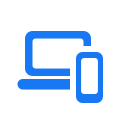

<p align="center">
  
</p>

<h1 align="center">Device Lab</h1>

<p align="center">
  <strong>Your site. On every screen.</strong><br>
  See any web page inside real iPhone, Pixel, Galaxy, iPad and Mac frames, right in Chrome.
</p>

<p align="center">
  Free · Open source (MIT) · No account · No tracking
</p>

---

## What it does

Click the Device Lab icon on any page. The page opens in floating device windows, at each device's
real screen size, so you can check your layout on many screens side by side, without leaving the
tab.

- **55 real devices.** iPhones, Pixels, Galaxys, foldables, iPads, Surface, laptops, desktops and
  smart displays, grouped by maker, with search and a Recent row. You can add up to 20 of your own.
- **Looks like the real thing.** Frames measured from real devices: the right corners, bezels,
  Dynamic Island, notch or punch hole, side buttons, and the matching status bar and browser bar
  (Safari, Chrome).
- **Official colours.** Pick the device colour from the title bar, like Desert Titanium or
  Midnight. Device Lab remembers it.
- **Rotate** phones, foldables and tablets between portrait and landscape.
- **Screenshots in one click.** Choose what to capture:
  - **Device**: the device with its frame, on a transparent background.
  - **Screen**: just the screen, like a screenshot taken on the phone.
  - **Full page**: everything you see, with the page behind and every open device.
  - **Device on background**: the framed device on a colour you choose.
- **Save it your way.** PNG, JPEG or WebP, with the file size shown before you save, or copy it
  straight to the clipboard.
- **Focus mode.** A calm dark background behind the devices that hides the page, so you only see
  the devices.

## Install

**Chrome Web Store:** coming soon.

**From the source code** (for now, or to try the latest version):

1. Install [Node.js](https://nodejs.org) 20 or newer.
2. Run:
   ```bash
   git clone https://github.com/sameeraherath/Device-Lab.git
   cd Device-Lab
   npm install
   npm run build
   ```
3. Open `chrome://extensions` and turn on **Developer mode** (top right).
4. Click **Load unpacked** and choose the `.output/chrome-mv3` folder.
5. Pin **Device Lab** from the puzzle-piece menu so the icon stays in the toolbar.

## How to use

1. Open the site you want to check.
2. Click the **Device Lab** icon in the toolbar.
3. Use the icon bar on the right to pick a device, add another one, rotate, take a screenshot or turn
   on Focus mode.
4. Drag a device by its frame to move it. The page inside stays fully usable: scroll, click and type
   as normal.

Close a device with the × in its title bar, or close all of Device Lab from the icon bar.

## Privacy

Device Lab collects nothing and sends nothing. It has no server, no analytics and no ads. Your
settings are saved only in Chrome on your computer, and screenshots never leave your computer. It
only works on the tab where you click its icon.

Read the full [privacy policy](PRIVACY.md).

### Permissions

| Permission                            | Why it is needed                                                                                                                                                                                   |
| ------------------------------------- | -------------------------------------------------------------------------------------------------------------------------------------------------------------------------------------------------- |
| `activeTab`                           | Works only on the tab where you click the icon, and takes screenshots when you ask.                                                                                                                |
| `scripting`                           | Adds the Device Lab windows and icon bar to that tab.                                                                                                                                              |
| `storage`                             | Remembers your settings on your computer: last and recent devices, colours, screenshot options, custom devices and Focus mode.                                                                     |
| `declarativeNetRequestWithHostAccess` | Many sites block being shown in a frame. This removes that block only for the tab you clicked, only for the same site, and only while Device Lab is open, so the page can show inside the devices. |

## Good to know

- **The page is your real page.** It is the same site, loaded at the device's screen size. Your
  layout, media queries and scripts run as they would on a screen that size.
- **It does not pretend to be the device.** The browser's user agent and pixel density stay the same
  as your computer's, so sites that check "is this an iPhone?" may act like they are on a desktop.
  The pixel ratio shown on each device is for information.
- **Screenshot size** follows how big the device is shown on your screen. For a larger image, make the
  Chrome window bigger.

## Contributing

Issues and pull requests are welcome.

- **Found a bug or a wrong device size?** [Open an issue](https://github.com/sameeraherath/Device-Lab/issues)
  and include the device name and, if you can, a screenshot.
- **Want to add or fix a device?** Devices and frames live in [`data/devices.json`](data/devices.json).
  Where each colour comes from is listed in [`data/device-colors.md`](data/device-colors.md).
- **Code changes:** fork the repo, make a branch, and run the checks below before opening a pull
  request.

### Development

```bash
npm install          # install, and generate WXT types
npm run dev          # opens Chrome with the extension loaded, reloads on save
npm run build        # production build into .output/chrome-mv3/
npm run zip          # zip for the Chrome Web Store, into .output/

npm run typecheck    # TypeScript
npm run lint         # ESLint
npm run format       # Prettier
```

After `npm run build`, click the reload button on the extension's card in `chrome://extensions`.

### Tech stack

- **[WXT](https://wxt.dev)** for the Manifest V3 build, dev mode and store zip.
- **TypeScript** and **[Preact](https://preactjs.com)** (about 4 kB, because the UI is added to other
  people's pages).
- **Plain CSS** inside a Shadow DOM, so the page's styles and Device Lab's never mix.
- **ESLint** and **Prettier**.

### Project layout

```
entrypoints/
  background.ts     Toolbar click: adds the frame rule and the UI; takes tab screenshots
  content/          The UI added to the page (index.tsx) and its styles (style.css)
components/         Preact components: device window and frame, icon bar, device picker,
                    colour picker, screenshot menu and dialog, Focus mode
lib/                Logic: devices and frames, window placement, storage, screenshot engine
data/
  devices.json      Every device (size, pixel ratio, group) and the frame presets
  device-colors.md  Where each official colour comes from
design/             App icon source files
public/icon/        Extension icons (16, 32, 48, 128 px)
```

## Roadmap

- Check the Galaxy S26 screen size on a real device (marked "not measured" for now).
- Optional user-agent and pixel-ratio emulation for sites that check the device.
- Screenshots at the device's own pixel ratio.
- Studio (coming soon).

## License

[MIT](LICENSE) © 2026 Sameera Herath. Free to use, change and share.
